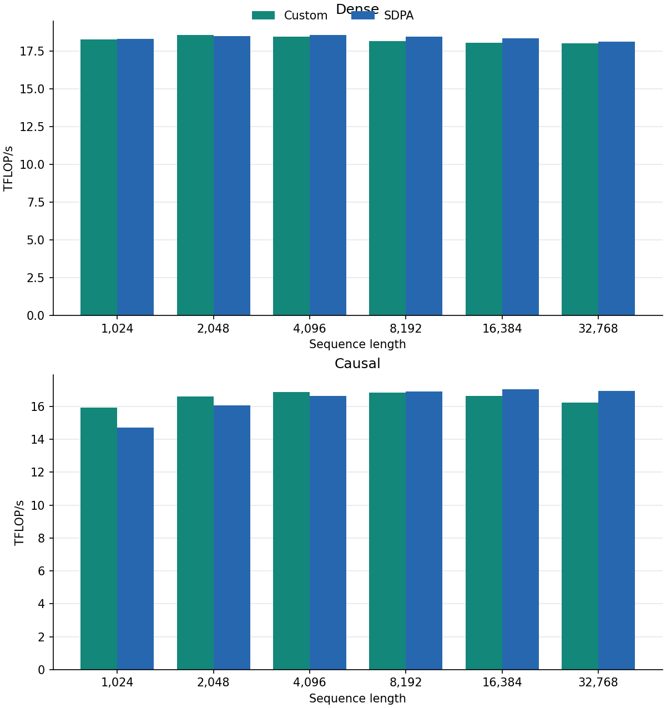

# flashattn-scratch

FlashAttention-2 forward kernels written from scratch in **CUDA C++ with inline PTX**, tuned for Ampere (developed on an **RTX 3050 6 GB Laptop**, sm_86).

Benchmarks compare kernel latency and throughput against **PyTorch SDPA** across head dimensions, head counts and sequence lengths up to 32K. On this GPU the kernel lands at **parity with SDPA** (0.88x to 1.10x, typically 0.92x to 1.02x). This is a learning and profiling project, not a replacement for PyTorch SDPA or the official FlashAttention libraries.

## Implementation

- Tensor Core `mma.sync` (`m16n8k16`) for QK^T and PV, with FP16 operands and FP32 accumulation.
- Online softmax in the base-2 domain (`softmax_scale · log2(e)` folded into the scores, `exp2f`) and output accumulation in registers.
- Four warps per block; K and V tiles streamed through shared memory with `cp.async`, each load overlapped with the other operand's compute (V_j loads during QK^T, K_{j+1} during softmax and PV).
- Q is staged through shared memory once, moved to registers with `ldmatrix`, and its rows are then reused for K/V, so the block needs only `max(64, 2·Bc)` tile rows of shared memory.

The forward kernel supports **dense and causal attention, GQA/MQA and unequal query/KV lengths**, including lengths that are not multiples of the tile size. A baseline backward pass is included.

[Design notes](#design-notes) | [Project layout](#project-layout) | [Build options](#build-options)

## Kernel Performance

**RTX 3050 6 GB Laptop (GA107, sm_86), PyTorch 2.7.1+cu118, CUDA 11.8.** FP16 inputs, FP32 accumulation, SDPA backend `auto`. Median of timed runs with an L2 flush before each run.

The batch size shrinks as N grows so every case processes the same token budget: **B · N = 16,384** (B = 16 at N = 1024, down to B = 1 at N ≥ 16384).

TFLOP/s is `4·B·H·N²·D` FLOPs (halved for causal) divided by the median latency.



Execution time (ms), lower is better. Head dimension 64, 8 Q/KV heads:

| Mask | Sequence length | Custom | SDPA |
|---|---:|---:|---:|
| Dense | 1024 | 2.121 | 1.888 |
| Dense | 2048 | 3.720 | 3.740 |
| Dense | 4096 | 7.456 | 7.453 |
| Dense | 8192 | 15.213 | 14.964 |
| Dense | 16384 | 30.862 | 30.127 |
| Dense | 32768 | 122.530 | 121.909 |
| Causal | 1024 | 1.078 | 1.168 |
| Causal | 2048 | 2.061 | 2.135 |
| Causal | 4096 | 4.043 | 4.105 |
| Causal | 8192 | 8.019 | 8.110 |
| Causal | 16384 | 16.565 | 16.116 |
| Causal | 32768 | 67.683 | 64.171 |

The full sweep covers **108 cases**: head dimension 64/128/256, 8/16/32 heads, sequence lengths 1024 to 32768, dense and causal. Custom throughput spans **15.7 to 18.5 TFLOP/s for dense** and **13.1 to 17.1 TFLOP/s for causal** attention.

[All cases](benchmarks/results/fwd.csv)

### Summary (custom vs SDPA, speedup = SDPA time / custom time)

| Head dim | Dense | Causal |
|---:|---|---|
| 64 | 0.98x to 1.02x (one outlier: 0.89x at N = 1024) | 0.94x to 1.08x |
| 128 | 0.91x to 0.95x | 0.93x to 1.00x |
| 256 | 0.97x to 1.00x | 0.88x to 1.10x |

What this means:

- **Parity, not a win.** The kernel matches SDPA within a few percent on most cases and does not beat it in general.
- **Where it is slower:** dense D = 128 (5 to 9 % behind at every length), and causal D = 256 at N ≥ 16384 (8 to 12 % behind).
- **Where it is faster:** short-sequence causal (N ≤ 4096) at D = 64 and D = 256, by up to 10 %.
- Throughput is flat at roughly 16 to 18 TFLOP/s for D = 64/128 and drops slowly as D and the causal share grow; the kernel is compute-bound here, so the remaining gap to SDPA is in instruction scheduling and the softmax/mask path, not memory traffic.

### Reproduce

```bash
# full sweep (default token budget), write CSV
python -m benchmarks.bench_fwd --csv benchmarks/results/fwd.csv

# chart + markdown table for one (D, H) slice
python -m benchmarks.plot_fwd --csv benchmarks/results/fwd.csv --dim 64 --heads 8
```

`plot_fwd` needs `matplotlib` (`pip install matplotlib`) and a CSV with the columns `D, N, B, H, causal, ext_ms, ext_tflops, sdpa_ms, sdpa_tflops`.

Use `--tokens 1` on `bench_fwd` for batch size 1 at every N instead of the constant token budget. The sweep takes a while at N = 32768 (seconds per call); `--budget-ms` caps the per-config time by shrinking warmup and iteration counts.

## Quick start

### Requirements

- Linux, NVIDIA GPU with compute capability 8.0 or newer.
- CUDA Toolkit with `nvcc` on `PATH`, matching the CUDA version used by your PyTorch install.
- Python 3.9+ and a CUDA-enabled PyTorch install.
- Tested: Python 3.10, PyTorch 2.7.1+cu118, CUDA 11.8, RTX 3050 6GB Laptop.

### Install

```bash
git clone https://github.com/akshay919191/flashattn-V1.git
cd flashattn-V1
pip install -e . --no-build-isolation
```

### Smoke test

```python
import torch
from flash_acc_reg import flash_attn

q = torch.randn(2, 16, 1024, 64, device="cuda", dtype=torch.float16)
k = torch.randn_like(q)
v = torch.randn_like(q)

out = flash_attn(q, k, v, causal=True)
print(out.shape)   # torch.Size([2, 16, 1024, 64])
```

## API

### High-level autograd wrapper

```python
from flash_acc_reg import flash_attn
O = flash_attn(Q, K, V, causal=False)
```

### Low-level kernel interface

```python
from flash_acc_reg import _C
O, L = _C.flash_fwd(Q, K, V, causal)
```

`L` is the per-row log-sum-exp in natural log (`m + log(l)`, FP32), needed for gradient computation.

### Tensor shapes

```
Q, O:  [B, H,    Sq,  D]
K, V:  [B, H_kv, Skv, D]
L:     [B, H,    Sq]
```

All tensors must be contiguous. `H_kv` must divide `H`: `H_kv == H` is standard MHA, `H_kv == 1` is MQA.

## Supported inputs

| Property | Status |
|---|---|
| Device | CUDA, compute capability 8.0+ |
| Dtype | FP16 |
| Accumulation | FP32 (MMA accumulators and softmax statistics) |
| Masking | None, or causal (bottom-right aligned) |
| GQA / MQA | Supported |
| Cross-attention | Supported (`Sq ≠ Skv`) |
| Sequence lengths | Any positive `Sq`, `Skv` (ragged tiles handled) |
| Head dimension | `{32, 64, 80, 96, 128, 160, 192, 224, 256}` |
| BF16, dropout, variable-length sequences | Not implemented |

Causal masking is aligned to the bottom-right corner: query row `i` attends to keys `0 … i + (Skv − Sq)`, matching FlashAttention-2. For `Sq == Skv` this is the usual lower-triangular mask. When `Sq > Skv`, the leading query rows have no visible key and their output is NaN.

Unsupported shapes (wrong head dimension, `H` not divisible by `H_kv`, non-contiguous tensors) raise an error at launch.

## Design notes

**Shared memory.** Tiles use a padded row stride of `D + 8` elements to avoid `ldmatrix` bank conflicts. Q is loaded into the same region that later holds K and V: it is read into registers, a barrier is taken, and then K/V overwrite it. The allocation is `max(64, 2·Bc)` rows × `(D + 8)` × 2 bytes.

| `D` | `Bc` | Tile rows | Shared memory per block |
|---:|---:|---:|---:|
|  32 | 64 | 128 | 10 KiB |
|  64 | 64 | 128 | 18 KiB |
|  80 | 64 | 128 | 22 KiB |
|  96 | 64 | 128 | 26 KiB |
| 128 | 32 |  64 | 17 KiB |
| 160 | 32 |  64 | 21 KiB |
| 192 | 32 |  64 | 25 KiB |
| 224 | 32 |  64 | 29 KiB |
| 256 | 32 |  64 | 33 KiB |

**Occupancy.** GA107 has 100 KiB of shared memory per SM, and CUDA reserves 1 KiB per resident block. Two blocks per SM therefore need at most about 49 KiB each; every configuration above fits, and the launcher requests the maximum shared-memory carveout so the driver actually provides it.

**Large head dimensions.** At `D = 256` each thread holds 128 FP32 output accumulators plus 64 registers of Q fragments, so the register file, not shared memory, is the limiting resource. Check `-Xptxas -v` for spills if you change `Bc` there.

**Causal.** KV tiles beyond a block's last visible key are skipped, and the mask is applied only to tiles that cross the diagonal (checked per warp).

**Ragged lengths.** The launcher selects the full-tile kernel when `Sq % 64 == 0` and `Skv % Bc == 0`. Otherwise it uses a variant with zero-filling `cp.async` loads, key-bound masking and guarded stores.

## Project layout

```
flashattn-V1/
├── csrc/
│   ├── fwd_kernel.cuh     # forward kernel (MMA, online softmax, masking)
│   ├── fwd_launch.cuh     # Bc dispatch, smem sizing, launch config
│   ├── bwd_kernel.cuh     # backward kernels (baseline)
│   ├── bwd_launch.cuh     # backward dispatch
│   ├── mma_helpers.cuh    # ldmatrix, tile loaders, pack helpers
│   ├── flashattn.cu       # entry points
│   └── bindings.cpp       # pybind11 module
├── flash_acc_reg/
│   ├── __init__.py        # compiled extension or JIT fallback
│   ├── _jit.py
│   └── ops.py             # autograd wrapper and input validation
├── tests/
├── docs/figures/          # charts generated by benchmarks/plot_fwd.py
└── benchmarks/
    ├── bench_fwd.py       # forward sweep vs SDPA
    └── plot_fwd.py        # chart + markdown table from the sweep CSV
```

## Build options

| Variable | Default | Effect |
|---|---|---|
| `TORCH_CUDA_ARCH_LIST` | Detected from GPU | Target arch(s), e.g. `"8.0;8.6"` |
| `FLASH_DEBUG` | `0` | `1` → `-O0 -G` for `compute-sanitizer` / `cuda-gdb` |
| `FLASH_FAST_MATH` | `1` | `0` → disable `--use_fast_math` |

## Clean rebuild

```bash
pip uninstall -y flash-acc-reg
rm -rf build *.egg-info
find . -name '*.so' -delete
rm -rf ~/.cache/torch_extensions/*/flash_acc_reg_jit
pip install -e . --no-build-isolation
```

## Troubleshooting

| Symptom | Fix |
|---|---|
| `nvcc not found` | Add CUDA Toolkit `bin/` to `PATH` |
| PyTorch/CUDA version mismatch | Compare `nvcc --version` with `torch.version.cuda` |
| `unsupported D_PAD` / head-dim error | `D` must be in the table under [Supported inputs](#supported-inputs) |
| NaN in the first rows of `O` | Causal with `Sq > Skv`: those rows have no visible key |
| Old behavior after editing CUDA | Clean build and JIT cache, then reinstall |

## References

- Dao et al., *FlashAttention*, NeurIPS 2022.
- Dao, *FlashAttention-2*, ICLR 2024.
- NVIDIA, [Ampere Tuning Guide — Occupancy](https://docs.nvidia.com/cuda/archive/12.5.1/ampere-tuning-guide/index.html#occupancy).